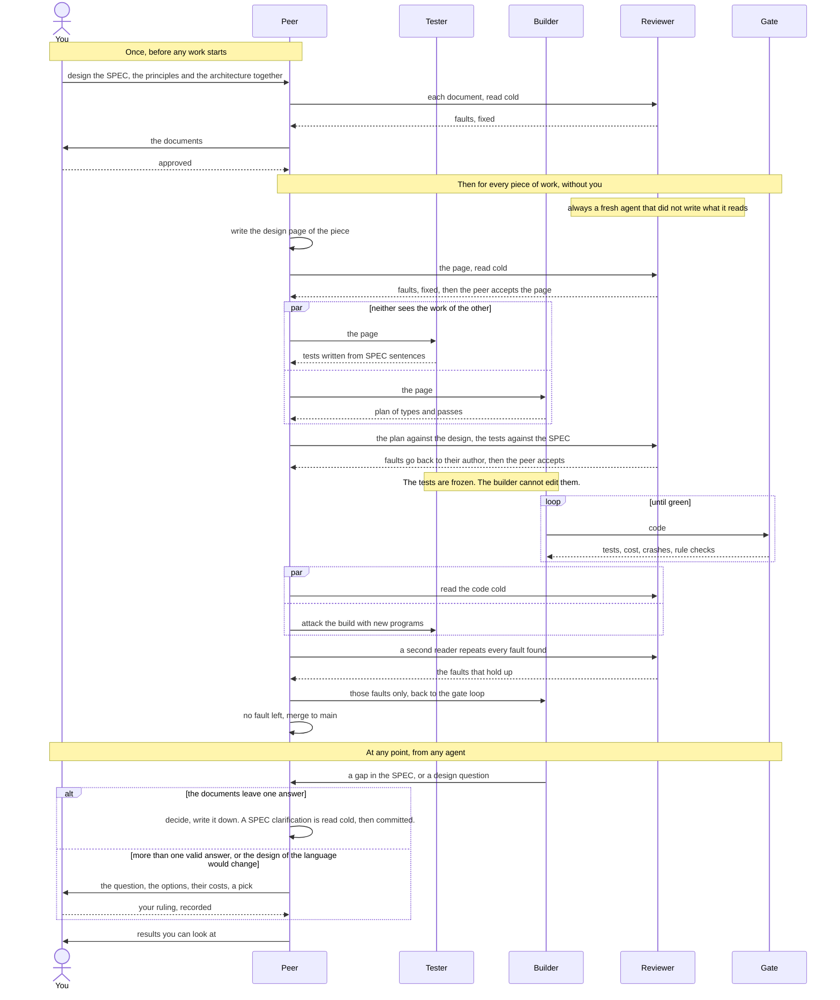

# The workflow, as shown to the owner on 2026-11-15

The peer's model of the work. Approved by the owner for testing on 2026-11-15, the owner's words in `owner-rulings-compiler-design.md`, seventh: once the design pass is over, the first piece of work tests it in a real case, with its numbers and its quality measured, so that a fault of the model is caught and fixed early. Approved for testing is not approved as final. The owner said of the reworded second principle "in a nutshell, sounds right-ish" and asked for "a simple textual mermaid diagram of the workflow (including me)", to make sure "that its as efficient as possible while ensuring the best possible quality as well" and that "there are not too much moving pieces". This is the diagram the peer showed in answer.

What it holds: three kinds of agent beside the peer (a tester, a builder, a fresh reader), one machine gate, five checks a piece (the page read cold; the review before code; the gate; the code read cold with the tester's attack; the second reader). The owner stands at two places: the three documents before any work, and a question the documents leave with more than one valid answer or that would change the language's design.

Where it differs from the pushed agent drafts, which have seven agent files: the test reviewer's check is part of the one review before code; the prober's job is the tester's second pass over the built code; the verifier is a fresh reader that repeats each fault; the explorer is a helper and no step. None of this has run. The first small piece is to measure it in rounds, tokens and time before more is built on it. `STANDARD.md` and `FINDINGS.md` name four readers and say other things in places; their sentences follow once the owner has confirmed the workflow.
